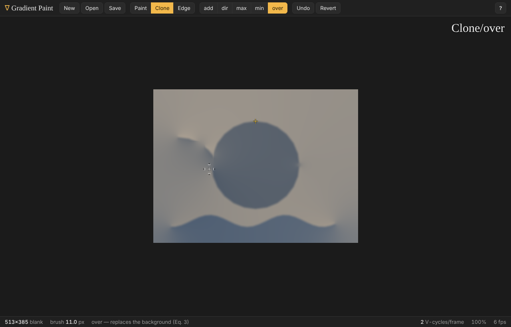

# Gradient Paint (WebGPU)

A web-native re-implementation of **Real-Time Gradient-Domain Painting** (James McCann & Nancy S. Pollard, SIGGRAPH 2008).
You paint on an image's *gradients* rather than its colours. A multigrid Poisson integrator running on the GPU
turns the edited gradient field back into an image every frame, so you see each stroke's effect live.

The integrator, brushes and blend modes are ported operation-for-operation from the original C++/GLSL application
(`gradient_paint` r2403) to WebGPU compute and render pipelines. The original ran in 16-bit float textures;
everything here runs in 32-bit float.



## Running

```bash
npm install
```

```bash
npm run dev
```

Open the printed URL in a browser with WebGPU (current Chrome, Edge, Safari, or Firefox). `npm run build` produces a
static site in `dist/`. Query parameters: `?size=1025x769` sets the initial canvas size (the default fills the window).

## Using it

The controls follow the original program. Press **F1** or **?** in the app for the full list.

| Input | Action |
| --- | --- |
| left-drag | paint with the current brush |
| right-drag (or Alt+drag) | configure: colour wheel (Paint; Shift = value −1…1), set source (Clone), capture an example edge (Edge) |
| ↑ / ↓ | brush: **Paint** (gradient brush), **Clone**, **Edge** |
| ← / → | blend mode: **add**, **dir**ectional, **max**, **min**, **over** |
| wheel, `[` `]` | brush size |
| Shift+click | continue the current stroke with a straight line |
| `g` | drag the current stroke around; it is re-rendered and re-integrated live |
| Backspace / Shift+Backspace | delete the current stroke / revert to the original |
| Ctrl+Z | multi-level undo (new) |
| `a`, Shift+A, `x` | colour adapt (auto-exposure), 10× contrast, reset exposure |
| `c`, PgUp/PgDn | compare with the original; inspect gx, gy and every multigrid level |
| `s` / Shift+S, `r` / Shift+R, `e`, `v` | single-step / resume, randomise / zero the solution, benchmark, V-cycles per frame |
| Ctrl+wheel, `+` `-` `0` `1`, middle-drag / Space+drag | zoom, fit, 100%, pan (new) |
| `n`, `o` (or drop a file), `d` / Ctrl+S | new canvas, open image (PNG/JPEG/WebP/PPM…), save PNG |

Changing the colour, size or blend mode re-renders the current stroke, as it did in the original.

## How it works

```
src/solver/spec.ts       grid hierarchy, L_h stencil (Eq. 8), magic Jacobi weights (Fig. 9) - shared by CPU & GPU
src/solver/reference.ts  float64 CPU reference of every kernel and the V-cycle (the test oracle)
src/solver/kernels.ts    WGSL compute kernels: rhs, residual, restrict, interpolate(+add), smooth, mean, recenter
src/solver/gpu.ts        GpuSolver: buffers per level, pre-built bind groups, one V-cycle = one dispatch list
src/paint/stroke.ts      SmoothStroke (arc-length resampling + smoothing)
src/paint/geometry.ts    stroke ribbons + joint blobs with the depth trick (centre 0.1, edge 0.9)
src/paint/painter.ts     gradient textures, undo snapshots, stroke rasterisation + blend modes, edge capture
src/paint/blend.ts       CPU model of the blend equations (Eqs. 1-4)
src/app/*                display shader, overlay, input handling, image I/O
```

Each frame:
1. Re-rasterise the current stroke into gx/gy over its pre-stroke snapshot.
2. Rebuild f = div g.
3. Run N V-cycles. Each one: residual → restrict down to 1×1 → bilinear interpolate → two magic-x Jacobi smooths per level → re-centre to the image mean.
4. Draw.

### Differences from the original

- **Coarse grid sizing.** The original halves `n → ⌊(n−1)/2⌋+1`, which is ideal for 2^k+1 sizes. For even sizes the
  last pixel has no coarse partner, convergence drops to ~0.6 per cycle, and the error rises for the first few cycles
  (the "increase in error … for certain image sizes" noted under Fig. 12). Here even sizes round *up*
  (`⌈(n−1)/2⌉+1`). That is identical on odd sizes and brings general sizes to ~0.45–0.5 per cycle with monotone
  convergence. The original scheme is still available (`coarsening: 'paper'`) and is covered by the tests.
- **Exact mean.** Re-centring uses an exact parallel reduction instead of a 64×64 bilinear pyramid. It also centres on
  the loaded image's mean instead of zero, so loaded images keep their colour balance (the original white-balanced
  everything).
- **Ties in max/min** keep the background instead of producing zero.
- The first segment of every stroke is drawn (the original skipped it).
- Additions: multi-level undo, zoom/pan, several V-cycles per frame (default 2), open/save of common formats.

### Known limitations

- Convergence slows for very elongated canvases, because coarsening collapses the short side first. Expect ρ≈0.6 at 8:1 and
  ≈0.9 at 50:1. Images are limited to ~4.2 megapixels (larger ones are downscaled on load).

## Tests

```bash
npm run test:unit
```

```bash
npm run test:gpu
```

**Unit tests** (Vitest, CPU), in `tests/unit`:
- Operators: level sizes, stencil coefficients, restriction/interpolation stencils and exactness, RHS = Neumann Laplacian, smoother fixed points.
- Convergence: the paper's ρ≈0.34 on 65×65 (power iteration), bounds for other sizes and aspect ratios, monotone error decrease, Fig. 12 behaviour.
- Integrating non-conservative fields converges to an independent exact least-squares solution (CG).
- Strokes, geometry, blend equations, HSV.

**GPU tests**, in `tests/gpu` (run in a real browser through WebGPU):
- Every WGSL kernel against the CPU reference.
- Full V-cycles against the reference solver (max difference ~6e-6).
- GPU convergence: ρ on 65×65, convergence to the exact solution, a megapixel canvas.
- Brush profiles against analytic ground truth, all five blend modes against the CPU model, clone offsets, edge capture → playback round trip, undo/revert, paint + integrate end to end.
- The display shader, rendered offscreen.

`npm run test:gpu` starts Vite and runs the suite in headless Chromium through [Playwright](https://playwright.dev).
Install it with `npm i -D playwright && npx playwright install chromium`, or point `NODE_PATH` at an existing install.
Use `--grep <text>` to filter tests and `--headed` to watch.
On machines without a GPU, Chromium falls back to SwiftShader, so the real WGSL is still exercised.
To test on your actual hardware, run `npm run dev` and open `/tests/gpu/index.html`.

> Headless Chromium with SwiftShader cannot show WebGPU canvases in screenshots. Once a canvas is configured, it also
> cannot map GPU buffers. The test page therefore never creates a canvas. For automated UI checks, `?present=0`
> runs the app without presenting.

## Credits

Algorithm, original application and paper: James McCann and Nancy S. Pollard, *Real-Time Gradient-Domain Painting*,
ACM SIGGRAPH 2008 — <http://gradient-paint.com>. The original code is "free for noncommercial use; please give credit".
